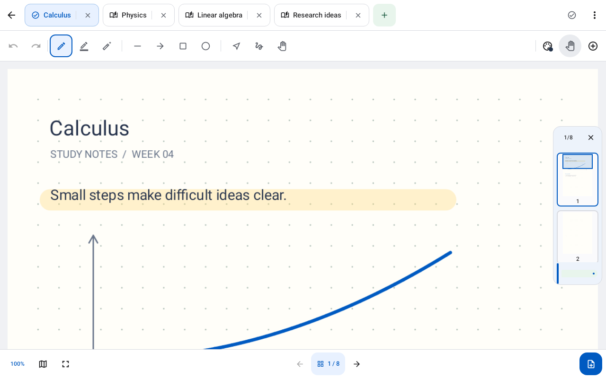
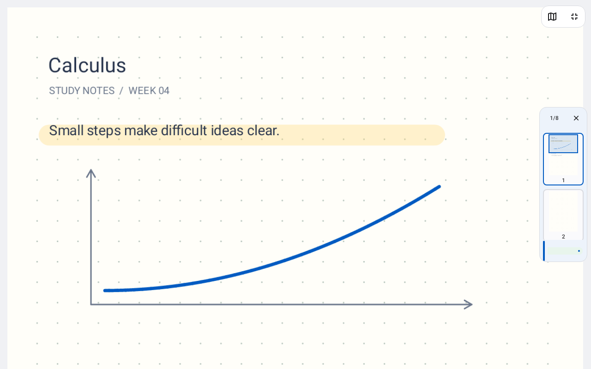
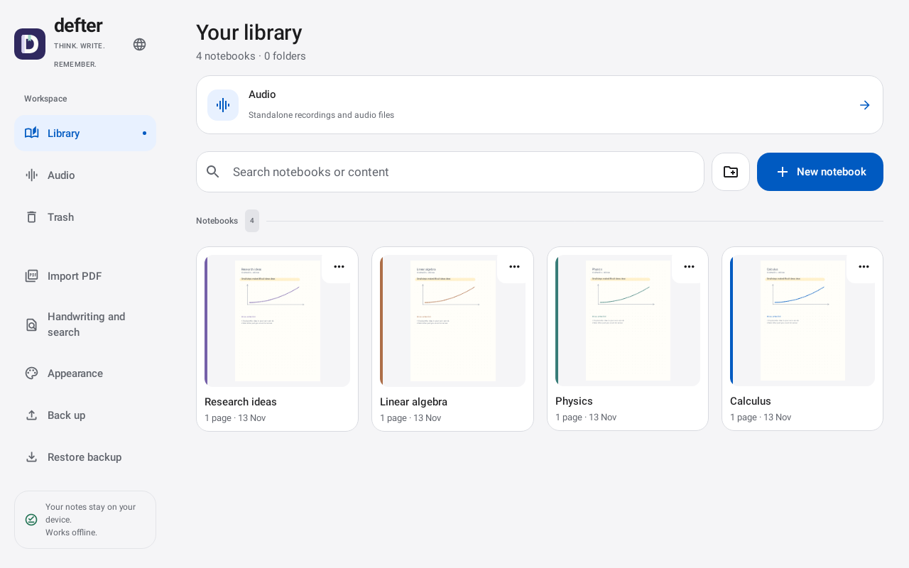
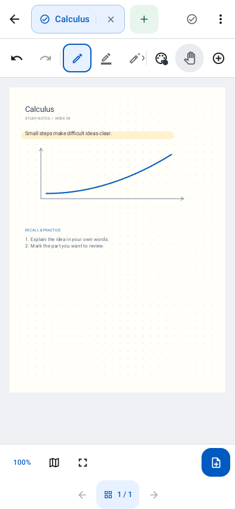
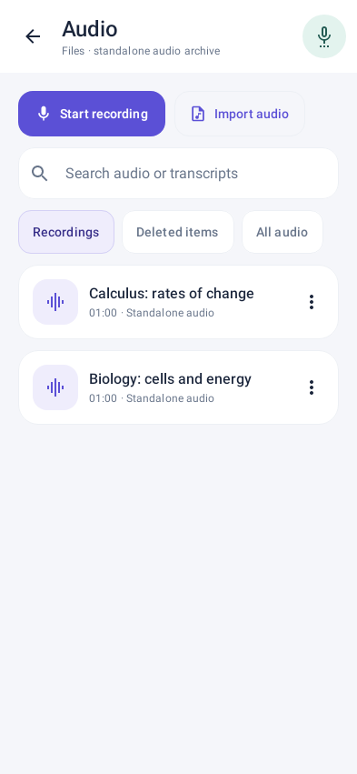
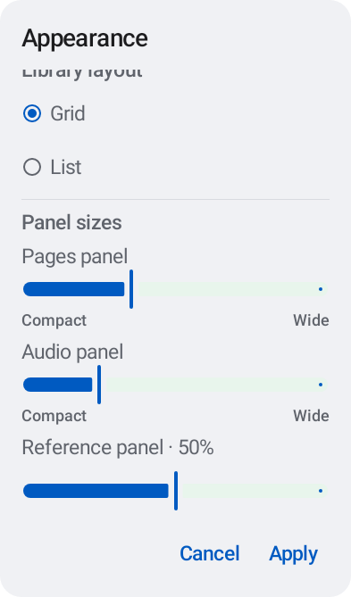
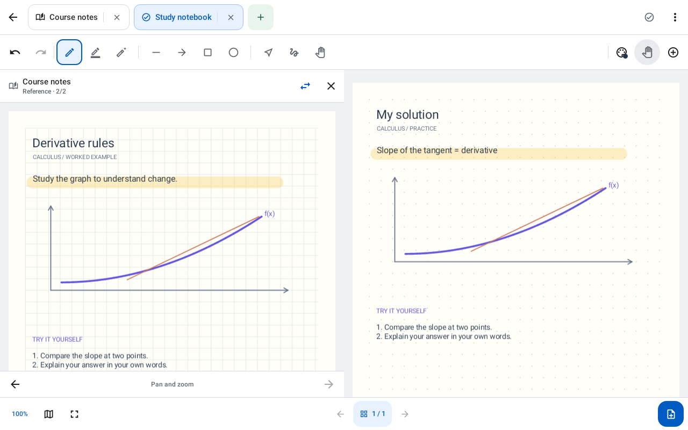
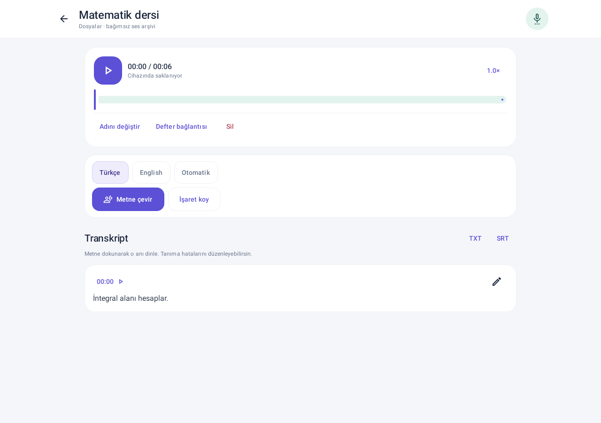
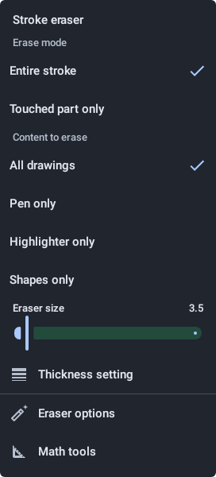

Defter lets you handwrite notes, annotate PDFs and turn recordings into searchable text on an Android phone or tablet.

<div align="center">

# Defter

[English](README.md) · [Türkçe](README.tr.md)

[Get started](#get-started) · [Language support](#language-support) · [Build from source](#build-from-source) · [Validation](docs/VALIDATION.md) · [Report an issue](https://github.com/ArdaHFO/defter-android/issues)


</div>

Notebooks and recordings stay on the device. You can organize them in folders, write beside a reference document, and link a moment in a recording to a page. Handwriting recognition and speech transcription work on the device after their models are downloaded. No account, API key or subscription is needed.

The current source is **0.8.0-alpha**, updated **14 November 2026**. It supports continuous scrolling with both neighboring pages visible and editable. Version 0.8 adds a page map and focus mode. The app opens in English. Choose **App language → Türkçe → Apply** to switch to Turkish. This changes the interface, not the contents of your notes.

## Preview

<p align="center">
  
  
  
</p>
<p align="center">
  
  
  
</p>
<p align="center">
  
  
  
</p>

These are native Robolectric/View renders of the app, using synthetic notes, silent audio and manually supplied transcript text. They show the interface, not physical-device behavior or speech accuracy. [Capture details](docs/images/README.md).

## Working with notes and audio

- **Notebooks and pages.** Use nested folders, first-page cover previews and title search. Add, duplicate, reorder, move or copy pages between notebooks. Scroll across page boundaries, or pull past the last page to add one. A notebook always keeps at least one active page.
- **Writing and editing.** Use a pressure-sensitive pen, highlighter, custom colors and adjustable widths on blank, lined, grid, dotted or Cornell paper. Whole-stroke and partial erasers can target pen, highlighter or shapes without removing text, images or PDF backgrounds.
- **Shapes and selections.** Draw lines, arrows, rectangles and ellipses, with optional angle snapping and square/circle constraints. Select objects or use the lasso to move, scale, recolor, duplicate or delete them. Copy editable selections between pages and notebooks. Text selections also use the Android clipboard.
- **Images and text.** Insert from files, the gallery, Android shares or supported clipboard content. Crop, rotate and resize images, or edit text boxes. Editing drafts survive screen rotation.
- **Workspace.** Open notebook tabs and a separately navigable reference page. On tablets the reference sits beside the editor, and on narrow screens it stacks above or below it. Swap it into the editor when you need to change it. The page map helps navigate long notebooks, while focus mode hides the toolbars and system bars. Themes and adjustable panels leave paper and ink colors unchanged.
- **Recording and playback.** Record while writing or keep audio separately in folders. Pause, resume, import, rename and move recordings. Add timed bookmarks with optional page links, and listen at 0.5–2× speed.
- **Transcripts.** Transcribe finished recordings offline, pause and resume the work, then search or edit the result. Jump to a timestamp, insert a section into a note, or export TXT/SRT. Transcription pauses if Android reports severe thermal conditions or a processing timeout.
- **Saving and backups.** Notes save automatically, with save status, retry and recovery copies for unsaved edits. Revision checks prevent stale edits from silently replacing a newer save. A `.defter` backup includes notebooks, assets, recordings and transcripts, with versioning and SHA-256 checks. Restore merges it with the current library.

Notebooks, pages and audio can be trashed and restored. Permanent deletion requires confirmation. Deleting a notebook keeps its recordings but removes links to deleted pages. Stop any affected recording and pause or stop transcription before deleting its items. Permanently deleted items are excluded from backups.

## Get started

Build the development APK below and install it on **Android 8.0 or later**. The repo contains neither model weights nor a store-signed release. Keep an external backup of important notes while using the alpha.

1. Choose **New folder** or **New notebook**. Open a folder first if the notebook belongs there, then select a cover color and paper template.
2. Leave **Finger: pan** on to navigate with a finger and write with a stylus. Use **Finger: draw** for finger drawing or a passive stylus. Two fingers zoom, and fit-width resets the view. A supported stylus side button temporarily selects the eraser, then restores your tool settings when released.
3. Use **Import PDF** or add images and text in the editor. The page number opens **Pages** for thumbnails and page actions. Long-press with a finger in pan mode for the clipboard menu. **Eraser options** and **Math tools** open the extra tool settings.
4. Use **Appearance** for themes and panel sizes. Open the map with its bottom icon, or enter focus mode with the fullscreen icon and leave with Back. The tab plus opens another notebook. **Open side by side** adds a reference, and **Edit reference** swaps it into the editor.
5. Open **Audio**, then **Start recording** or **Import audio**. Recording asks for microphone permission and shows a foreground notification. Add bookmarks while writing to link audio to the current page.
6. Download the speech model under **Speech model → Download model**. Stop the recording, choose **Turkish**, **English** or **Automatic**, then **Transcribe**. Review the text before using it. For handwriting, open **Handwriting and search**, download a language model and use **Prepare handwriting for search**. Update that index after adding or changing ink.
7. Use **Back up** to save an editable `.defter` file outside the device. **Restore backup** merges it into the library. In **Trash**, or audio's **Deleted items**, select individual items or **Select all**, then confirm **Delete selected** only when you want permanent removal.

The [Turkish guide](docs/DEVELOPMENT.tr.md) covers the controls and storage in more detail. Switch the interface to Turkish to follow its button names. UI language, handwriting recognition language and transcription language are separate settings.

## Language support

| Feature | Available languages |
| --- | --- |
| Interface | English by default, or Turkish |
| Handwriting | Turkish (`tr-TR`) and English (`en-US`) through ML Kit |
| Speech controls | Turkish (`tr`), English (`en`) and Automatic (`auto`) |

The downloaded [Whisper base model](https://huggingface.co/openai/whisper-base) has a **99-language vocabulary**. Automatic mode can attempt detection across that set. Defter does not offer 99 manual language choices, and those languages have not all been tested in the app. The count comes from this model's `n_vocab = 51865`. The engine's Cantonese entry applies to other models and is outside this base model's set. Transcription keeps the source language. Translation is disabled.

## Data and model downloads

Notes, audio and transcripts stay in app-local storage. Import and export use Android's document picker without broad storage permission. There is no cloud sync or note/audio upload workflow. Network access is used for optional model downloads, and the microphone opens only when you start a recording.

Speech uses **whisper.cpp v1.9.5**, included in the repo, and the multilingual Whisper base model. The **147,951,465-byte** model is about **148 MB**, downloaded separately with resume support and size/SHA-256 verification. Transcription then runs offline. See [model provenance](third_party/WHISPER_SOURCE.md).

Handwriting uses **ML Kit 19.0.0**, with separate downloads for its language models. It includes Google client-library dependencies. Download and recognition on devices without the Google Play Services app have not been verified.

## Limits to know before using it

- **Device support.** Android 8.0 / API 26 is the minimum, with target SDK 35. Pressure, side buttons and palm rejection depend on the device's Android input support. Physical S Pen behavior, microphone sessions, long recordings, battery use, thermal behavior and transcription speed still need target-device testing. Installation alone does not establish usable performance.
- **Recognition.** Transcription happens after recording. There are no live captions, speaker separation or translation. Noise and overlapping speech can produce errors. Handwriting recognition reads ink strokes, not photos or printed PDFs. Photo OCR, PDF text search, equation recognition/LaTeX, pencil textures, AI study tools, collaboration and cloud sync are not implemented.
- **Editing.** The reference pane stays read-only until swapped into the editor and has its own single-page view. Undo keeps up to 60 edits per page. Cached history survives natural page transitions, but direct navigation resets the target history and clean evicted history can be dropped. Unsaved or failed saves are protected separately. Editable selections in the clipboard last only for the app process.
- **Files.** Original imported PDFs are retained, but notebook PDF exports rasterize the background and do not preserve its searchable text layer. Imported images are orientation-corrected and converted to PNG rather than kept byte-for-byte. Audio format support depends on Android codecs. Recording uses roughly 64 kbit/s mono AAC/M4A in parts, and process termination can lose the last unfinished part.
- **Backups and deletion.** V1/V2 documents can be read, while new saves use V3, which older APKs cannot read. Keep compatible backups before changing versions. Permanent deletion updates the library before removing unshared files. Failed cleanup can leave an unreferenced file on disk, excluded from backups. It is not secure erasure.

<details>
<summary>File and memory limits</summary>

| Item | Limit |
| --- | --- |
| Imported PDF | 64 MiB / 2,000 pages |
| Imported audio | 256 MiB per file |
| Decoded audio | 24 hours per file, even if multipart recording metadata allows more |
| Handwriting request | 200,000 ink points |
| JSON document | 32 MiB |
| Expanded backup | 512 MiB total, 50,000 entries |
| Backup entry | 64 MiB normally, 256 MiB for audio |
| Imported image | 4096-pixel edge, 8,388,608 pixels |

The editor caches at most five decoded pages, using smaller previews for neighbors and about four million pixels for a directly opened active page. Placeholders do not accept ink until loaded. Page-map thumbnails load only when visible, with at most two concurrent jobs. These are resource limits, not paid notebook or page quotas.

</details>

## Build from source

Use **JDK 17**, **Gradle 8.13**, **Android SDK 35 / Build Tools 35.0.0**, **NDK 28.2.13676358** and **CMake 3.22.1**. Initial dependency downloads need internet access. The pinned whisper.cpp source is included, so CMake does not download the engine.

```powershell
git clone https://github.com/ArdaHFO/defter-android.git
cd defter-android

# Set JAVA_HOME and ANDROID_HOME (or ANDROID_SDK_ROOT) to installed tools.
.\build.ps1 -Action Check
.\build.ps1 -Action Build
```

The APK is written to `app/build/outputs/apk/debug/app-debug.apk`.

| Action | What it does |
| --- | --- |
| `Check` | Runs local tests and Android Lint. Default action, no APK. |
| `Test` | Runs JVM/Robolectric tests, no APK. |
| `Native` | Compiles the C/C++ engine for the four configured ABIs, no APK. |
| `Build` | Builds a development APK and creates a debug signing key if needed. |

The ABIs are `arm64-v8a`, `armeabi-v7a`, `x86_64` and `x86`. The PowerShell helper keeps caches under `.local/`. A custom `-SocketDirectory` must be writable and shorter than 85 characters. Keep `.local/debug.keystore` private and retain it to update installations signed with that key. A different key will not update the same installation. Keys and caches are excluded from the repo.

Tests under `app/src/androidTest` need a separate emulator or device and install test APKs. Compiling them does not run them.

## Validation

The **13 November 2026 / 0.8.0-alpha** records show **393 passing JVM/Robolectric tests** and **13 passing installed R8-release Android tests on API35 x86_64**. Debug/release Lint had zero errors and 22/20 warnings. Existing content hashes were checked before and after the synthetic test additions.

Three English preview checks were rerun for the **14 November publication**. Other current layouts came from the passing 0.8 regression captures. The full test suite, native tests and APK build were not rerun for publication or this README edit. [Validation details](docs/VALIDATION.md) distinguish those results and the remaining physical-device checks.

## Code and contributions

The app uses Kotlin, Compose, a native Android Canvas, atomic JSON files and Whisper C/C++. It does not use Jetpack Ink or Room.

| Path under `app/src/` | Contents |
| --- | --- |
| `main/java/dev/defter/app/model/`, `main/java/dev/defter/app/data/` | Documents, persistence, imports, backups and recovery |
| `main/java/dev/defter/app/ink/`, `main/java/dev/defter/app/ui/` | Drawing, gestures and notebook/audio screens |
| `main/java/dev/defter/app/localization/` | Interface languages |
| `main/java/dev/defter/app/audio/`, `main/java/dev/defter/app/recognition/` | Recording, transcription and handwriting |
| `main/cpp/` | Native engine bridge |
| `test/`, `androidTest/` | JVM and Android tests |

`third_party/` holds the native source and notices. `docs/` contains the guide, validation records and previews.

Bug reports should include the device, Android version and steps to reproduce, preferably with synthetic notes or recordings. Persistence changes need to preserve existing documents and backup compatibility. State which local, native and device checks you actually ran.

## License and credits

There is no repository-wide license for Defter's original code. Dependency licenses do not grant a license to the whole app.

The vendored [whisper.cpp](https://github.com/ggml-org/whisper.cpp) keeps its [MIT license](third_party/whisper.cpp/LICENSE), [author list](third_party/whisper.cpp/AUTHORS) and nested notices. The model has a separate [MIT license](third_party/WHISPER_MODEL_LICENSE.txt). Copies of both notices are also in the app's assets. Kotlin, AndroidX, ML Kit and other dependencies retain their own licenses.
