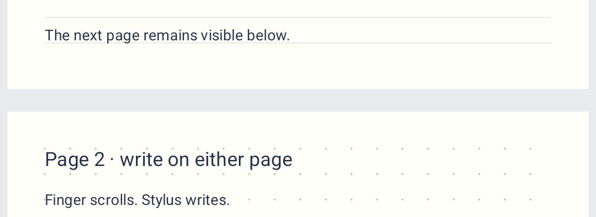

Defter lets you handwrite notes, annotate PDFs, and turn recordings into searchable text on your Android phone or tablet.

<div align="center">

# Defter

**Your notebooks, documents, and recordings in one place.**

An Android notebook with pressure-sensitive ink, PDF annotation, local backups, and on-device speech transcription.

[English](README.md) · [Türkçe](README.tr.md)

[Get started](#get-started) · [Language support](#language-support) · [Build from source](#build-from-source) · [Validation](docs/VALIDATION.md) · [Report an issue](https://github.com/ArdaHFO/defter-android/issues)


</div>

## Overview

Defter brings handwritten pages, imported documents, and audio into a local library. Organize notebooks into folders, write beside a reference document, and link a recording to the page you were using. Optional handwriting and speech models run on the device after download. No account, transcription API key, or subscription is required.

This repository contains **0.6.0-alpha**, updated on **3 November 2026**. The app starts in **English**, regardless of the device language. **App language → Türkçe → Apply** switches to Turkish and saves the preference. Notebook names, notes, recording titles, and transcripts keep their original content.

Version 0.6 adds true continuous vertical scrolling: portions of adjacent pages remain visible together, and the stylus edits the page it touches. Drag or fling with a finger, pinch to zoom, and pull beyond the final page to append once. The refreshed blue/gray interface uses clearer hierarchy, adaptive large-text layouts, separate tab-close targets, and short transitions that respect system animation settings. Existing PDF, audio, recognition, clipboard, folder, and trash features remain available.

## Preview

<p align="center">
  
  
</p>
<p align="center">
  
  
</p>

These previews show the English interface with synthetic notebook and audio content. They are native Robolectric renders, not physical-device screenshots or proof of speech-recognition accuracy. [Screenshot provenance](docs/images/README.md) identifies the capture method and scope.

## Implemented features

| Area | What is available in 0.6 |
| --- | --- |
| Library organization | Create and rename folders, including nested folders. Create notebooks with a cover color, rename them, move them between folders, and search notebook titles and indexed page content. |
| Notebook and audio trash | Trash and restore items. Select multiple visible trash items, select all, clear the selection, and confirm permanent deletion. Deleting a notebook preserves its linked recordings and removes links to deleted pages. Stop affected recordings and pause or stop active transcription before deleting affected items. |
| Pages | Add and duplicate pages, view real thumbnails, reorder with drag-and-drop or arrows, trash and restore pages, and copy or move pages between notebooks. A notebook retains at least one active page. |
| Paper | Blank, lined, grid, dotted, and Cornell templates, with light and dark paper colors. |
| Ink and colors | Pen and highlighter, pressure-dependent stroke width when the device supplies pressure, preset colors, a custom HEX color, and adjustable width. |
| Erasing | Whole-stroke or partial erasing, with filters for all drawings, pen, highlighter, or shapes. The eraser leaves text, images, and PDF backgrounds intact. |
| Geometry | Lines, arrows, rectangles, and ellipses, plus optional 15°/30°/45°/90° angle snapping and square/circle constraints. |
| Selection and clipboard | Select one object or use the lasso for a group. Move, duplicate, recolor, scale, or delete the selection. Copy/cut/paste editable ink, shapes, images, and text between pages and notebooks. Selected plain text also uses the Android clipboard. |
| Images and text | Insert images from files or the gallery, paste supported image/text content, and receive Android shares. Crop and rotate images, resize with their aspect ratio preserved, and edit an existing text box's content, size, and color. Editing and crop drafts survive rotation. |
| Touch and pen input | **Finger: pan** is the default. Fingers navigate while the stylus uses the selected tool. **Finger: draw** lets fingers use that tool too. The preference persists. Two-finger zoom and a fit-width reset are available. A passive stylus reported as a finger uses drawing mode. |
| Quick editing and navigation | Long-press with a finger in panning mode for copy, cut, paste, select all, or delete selection. Scroll continuously across page boundaries; both neighboring pages can be visible and editable. Pull below the final page to add one page, with visible progress and release feedback. |
| Stylus side button | Hold an Android-reported stylus side button for a temporary eraser, then release to return to the previous tool, color, and width. Uses standard Android events, not a Samsung-only SDK. |
| History and workspace | Labeled Undo/Redo controls, notebook tabs with a last page per tab, and a separately navigable read-only reference pane. Swap the reference into the editing pane. Tablet panes sit side by side, while narrow screens stack them. Session restoration preserves tab/page/reference state when Android restores the activity. |
| PDF workflow | Import a PDF as notebook pages and annotate it. Preserve its original PDF asset locally. Export a notebook, including its ink, shapes, text, images, and rendered backgrounds, as PDF. |
| Handwriting recognition | Download a Turkish or English handwriting model. Recognize selected strokes or a whole page, review and correct the result, and optionally replace the original ink. Index recognized handwriting and search it alongside text boxes. |
| Local saving and recovery | Automatic local saves with visible status, revision checks that prevent a stale editor from silently overwriting a newer save, retry support, and recovery of unsaved edits as separate copies. Malformed or unsupported documents produce an error rather than opening as empty notes. |
| Editable backups | Export the complete library as a versioned `.defter` ZIP backup with SHA-256 checks. Include notebooks, assets, recordings, and transcripts. Restore by merging with existing content. Permanently deleted items are excluded. |
| Recording and audio organization | Record inside a notebook or independently in the audio archive/folders. Pause, resume, stop, or import an audio file. Keep a visible recording strip while writing, add time bookmarks with optional page links, rename recordings, link/unlink them to notebooks, and move them between folders. |
| Playback | Seek through a recording, jump to bookmarks or transcript timestamps, and choose 0.5–2× playback speed. |
| Local transcription | Download and verify the multilingual Whisper base model. Transcribe completed recordings on-device with progress, pause/resume checkpoints, and restart confirmation when replacing a transcript. The service pauses for severe thermal conditions or an Android processing timeout. See the exact language scope below. |
| Transcript tools | Search recording titles and transcript content, edit transcript sections, listen from their timestamps, insert a section into the open note page, and export TXT or SRT. |
| Interface language | English by default, with a persistent Turkish option available from the library and editor. UI language, handwriting language, and speech language are separate choices. |

<p align="center"></p>

## Language support

| Feature | Exact current scope |
| --- | --- |
| App interface | **2 languages** — English and Turkish. English is the default even on a Turkish device. |
| Handwriting recognition | **2 selectable models** — Turkish (`tr-TR`) and English (`en-US`), through ML Kit. Other ML Kit languages are not exposed by this app. |
| Speech transcription controls | **Turkish (`tr`)**, **English (`en`)**, or **Automatic (`auto`)**. These are the only accepted explicit modes in the UI and native bridge. |
| Underlying speech model | Multilingual **Whisper base**, with a **99-language vocabulary**. Auto delegates language detection to that model and can attempt speech in its broader language set. There is no picker for manually selecting each of those 99 languages, and they have not all been validated in Defter. |

The **99** figure describes the downloaded model, not 99 manually selectable or independently tested app languages. It is based on the pinned model's `n_vocab = 51865` and the vendored engine's language-count calculation. The engine also lists Cantonese for other models, but that additional entry is outside this base model's 99-language set. Transcription keeps speech in its source language. Translation is disabled.

<details>
<summary>The base model's 99 language codes</summary>

The names below follow the vendored model language table. This is model coverage, not a claim of equal accuracy across languages.

Afrikaans (`af`), Albanian (`sq`), Amharic (`am`), Arabic (`ar`), Armenian (`hy`), Assamese (`as`), Azerbaijani (`az`), Bashkir (`ba`), Basque (`eu`), Belarusian (`be`), Bengali (`bn`), Bosnian (`bs`), Breton (`br`), Bulgarian (`bg`), Burmese/Myanmar (`my`), Catalan (`ca`), Chinese (`zh`), Croatian (`hr`), Czech (`cs`), Danish (`da`), Dutch (`nl`), English (`en`), Estonian (`et`), Faroese (`fo`), Finnish (`fi`), French (`fr`), Galician (`gl`), Georgian (`ka`), German (`de`), Greek (`el`), Gujarati (`gu`), Haitian Creole (`ht`), Hausa (`ha`), Hawaiian (`haw`), Hebrew (`he`), Hindi (`hi`), Hungarian (`hu`), Icelandic (`is`), Indonesian (`id`), Italian (`it`), Japanese (`ja`), Javanese (`jw`), Kannada (`kn`), Kazakh (`kk`), Khmer (`km`), Korean (`ko`), Lao (`lo`), Latin (`la`), Latvian (`lv`), Lingala (`ln`), Lithuanian (`lt`), Luxembourgish (`lb`), Macedonian (`mk`), Malagasy (`mg`), Malay (`ms`), Malayalam (`ml`), Maltese (`mt`), Maori (`mi`), Marathi (`mr`), Mongolian (`mn`), Nepali (`ne`), Norwegian (`no`), Norwegian Nynorsk (`nn`), Occitan (`oc`), Pashto (`ps`), Persian (`fa`), Polish (`pl`), Portuguese (`pt`), Punjabi (`pa`), Romanian (`ro`), Russian (`ru`), Sanskrit (`sa`), Serbian (`sr`), Shona (`sn`), Sindhi (`sd`), Sinhala (`si`), Slovak (`sk`), Slovenian (`sl`), Somali (`so`), Spanish (`es`), Sundanese (`su`), Swahili (`sw`), Swedish (`sv`), Tagalog (`tl`), Tajik (`tg`), Tamil (`ta`), Tatar (`tt`), Telugu (`te`), Thai (`th`), Tibetan (`bo`), Turkish (`tr`), Turkmen (`tk`), Ukrainian (`uk`), Urdu (`ur`), Uzbek (`uz`), Vietnamese (`vi`), Welsh (`cy`), Yiddish (`yi`), and Yoruba (`yo`).

</details>

## Get started

Build a development APK using the instructions below, then install it on an Android 8.0+ phone or tablet. This source repository does not include model weights or a store-signed release. Keep a backup of important notes while evaluating the alpha.

1. Choose **New folder** or **New notebook**. Open a folder first to create a notebook inside it, then choose the cover color and first page template.
2. Leave **Finger: pan** enabled to move around with your finger and write with your stylus. Switch to **Finger: draw** for finger drawing or a passive stylus. Choose a tool, color, and width. **Eraser options** and **Math tools** open their extra controls.
3. Use **Import PDF** in the library, or add images and text from the editor. The page-number control opens **Pages** for thumbnails, reordering, and page actions. Scroll naturally between pages. Pull beyond the final page to append one, or use the page arrows for direct navigation.
4. The tab plus opens another notebook. **Open side by side** adds a reference, and **Edit reference** swaps it into the editable side. A long press in finger panning mode opens the clipboard menu.
5. Open **Audio** from the library or the notebook microphone action. Choose **Start recording** or **Import audio**. Recording requests microphone permission and shows a foreground notification. Add a bookmark while writing to link the time to the current page.
6. In Audio, open **Speech model → Download model**, or choose **Transcribe** to open the model dialog when needed. The approximately **148 MB** download is resumable and verified against a pinned SHA-256 hash. Once ready, stop recording, select **Turkish**, **English**, or **Automatic**, and choose **Transcribe**. Review and edit the result before using it.
7. Open **Handwriting and search**, choose Turkish or English, and use **Download language model**. **Prepare handwriting for search** indexes notebook ink. New ink invalidates the old recognition result, so update the index after editing.
8. Use **Back up** to save an editable `.defter` library backup outside the device. **Restore backup** merges it into the library. PDF and TXT/SRT exports provide separate sharing formats.
9. In **Trash**, select items or use **Select all**, then **Delete selected** and confirm. Audio has the same flow under **Deleted items**. The action applies to the visible selection and cannot be undone after confirmation.

The [detailed Turkish guide](docs/DEVELOPMENT.tr.md) covers the controls, storage behavior, and device testing. To follow its Turkish button names, choose **App language → Türkçe → Apply**. Switching UI language does not translate your content or select a speech/handwriting model.

## Data and models

Notes, recordings, and transcripts stay in app-local storage. Imports and exports use Android's document picker without broad storage permission. There is no account login, cloud synchronization, or note/audio upload workflow. Network access is used for optional model downloads. The microphone is opened only after the user starts recording.

Speech uses the vendored **whisper.cpp v1.9.5** and the pinned multilingual **Whisper base** model, a **147,951,465-byte** download, approximately 148 MB. Weights are not checked in or bundled with the APK. Download verification checks both size and SHA-256. After download, transcription runs offline without an API key or subscription. Model provenance and licenses are documented in [third_party/WHISPER_SOURCE.md](third_party/WHISPER_SOURCE.md).

Handwriting uses **ML Kit 19.0.0** with separate, explicitly downloaded language models. It brings Google client-library dependencies, so Defter is not described as Google Play Services independent. Model download and recognition on devices without the Google Play Services app require separate verification.

## Compatibility and limits

- **Android 8.0 / API 26 or later**, targeting SDK 35. The four configured ABIs are `arm64-v8a`, `armeabi-v7a`, `x86_64`, and `x86`. Installation support does not guarantee useful transcription speed on older or low-memory devices. Physical S Pen behavior, palm rejection, microphone sessions, long recordings, battery use, and thermal performance still need target-device testing.
- Pressure and side-button support depend on Android input events supplied by the hardware. The app cannot make a Samsung pen work with incompatible hardware. No manufacturer-specific remote-control behavior is promised.
- Speech transcription runs **after recording**. There are no live captions, speaker separation, or translation. Noise, distant microphones, and overlapping speech can produce errors. The native-audio validation is not an accuracy benchmark for all 99 model languages.
- Handwriting recognition reads ink strokes, not photographs or printed PDF text. PDF text-layer search, photo OCR, equation recognition/LaTeX, pencil textures, AI study tools, collaboration, and cloud sync are not implemented. Sync is deferred by user preference.
- The reference pane is read-only until swapped into the editor. It is not a second independent editing session. The main editor scrolls continuously; the reference keeps its independent single-page view.
- Undo retains up to **60 edits per page**. Natural activation restores histories for cached pages. Explicit page navigation resets the target history; clean evicted histories may be dropped. Pending or failed saves remain protected independently of the five-page decoded cache. Editable selection clipboard data lasts for the app process. If the process exits, copy the selection again.
- Original imported PDF bytes are retained. PDF backgrounds are rasterized for display and PDF export, so the original searchable PDF text layer is not carried into the exported notebook. Imported images are orientation-corrected and normalized to PNG, with at most a 4096-pixel edge and 8,388,608 pixels. Their original bytes are not retained. The editor keeps at most five decoded pages, with a lower preview budget for neighbors and about four million pixels for an explicitly opened active page. Placeholders reject ink until loaded; geometry remains available after eviction.
- Audio format support depends on Android's actual codecs, not just the extension. Microphone capture uses mono AAC/M4A at approximately 64 kbit/s and splits long recordings into committed parts. Process termination can lose the final unfinished part. A single decoded audio file must not exceed 24 hours, even though the multipart recording metadata permits a larger total.
- Technical limits include **64 MiB / 2,000 pages per imported PDF**, **256 MiB per imported audio file**, **200,000 ink points per handwriting request**, **32 MiB per JSON document**, and **512 MiB total expanded backup size**. General backup entries are limited to 64 MiB, audio entries to 256 MiB, and archives to 50,000 entries. These are resource guards, not a notebook/page subscription quota.
- V1/V2 documents are readable, while new saves use V3. Older APKs cannot read V3 documents. Retain compatible backups before changing versions. Permanent deletion commits the library change first and removes unshared files afterward. Failed physical cleanup can leave an unreferenced file on disk, excluded from backups. This is not secure-erasure functionality.

## Build from source

The checked-in build uses **JDK 17**, **Gradle 8.13**, **Android SDK 35 / Build Tools 35.0.0**, **NDK 28.2.13676358**, and **CMake 3.22.1**. The first dependency download requires internet access. The pinned whisper.cpp source is included, so CMake does not download its engine source.

```powershell
git clone https://github.com/ArdaHFO/defter-android.git
cd defter-android

# Set JAVA_HOME and ANDROID_HOME (or ANDROID_SDK_ROOT) to installed tools.
.\build.ps1 -Action Check
.\build.ps1 -Action Build
```

The APK is written to `app/build/outputs/apk/debug/app-debug.apk`.

| Action | Result |
| --- | --- |
| `Check` | Unit/UI tests and Android Lint. The script default. No APK. |
| `Test` | Local JVM/Robolectric tests. No APK. |
| `Native` | C/C++ engine compilation for all four configured ABIs. No APK. |
| `Build` | Development APK and, if absent, a local debug signing key. |

The PowerShell helper isolates caches under `.local/` and handles short temporary paths needed by Windows. A custom `-SocketDirectory` must be writable and shorter than 85 characters. Keep `.local/debug.keystore` private and retain it if future development APKs must update the same installation. A newly generated key will not match an existing installation signed with a different key. Keys and caches are excluded from the repository.

Android instrumentation sources are under `app/src/androidTest`. Running them requires a separate emulator or device and installs test APKs. Compilation is distinct from executing those tests.

## Validation

The completed **0.6.0-alpha** validation records **342 passing tests in 56 suites**, **0 Lint errors / 18 warnings / 1 informational finding**, and **7 passing Android instrumentation tests on Android 15 x86_64**. The update preserved all nine inventoried files before new synthetic fixtures were added. The native Canvas pixel check verifies both papers and the gap.

[Validation and retained evidence](docs/VALIDATION.md) describe test scope, fixes, APK integrity, and the emulator display-capture limitation. These are retained development results, not a full regression rerun for publication. Physical Tab S10 FE/S Pen behavior and recognition accuracy still require device testing. Historical speech inference is not reclassified as fresh 0.6 inference testing.

## Project map

| Path | Responsibility |
| --- | --- |
| `app/src/main/java/dev/defter/app/model/` | Notebook, page, audio, and transcript models. |
| `app/src/main/java/dev/defter/app/data/` | Atomic JSON persistence, imports, backups, and conflict recovery. |
| `app/src/main/java/dev/defter/app/ink/` | Canvas input, page-edge gestures, rendering, selection, and geometric editing. |
| `app/src/main/java/dev/defter/app/ui/` | Compose notebook/audio workspaces, language selection, and bulk-trash controls. |
| `app/src/main/java/dev/defter/app/localization/` | Persistent UI language selection and Android string/plural catalogs. |
| `app/src/main/java/dev/defter/app/audio/` | Recording, playback, decoding, model download, and transcription. |
| `app/src/main/java/dev/defter/app/recognition/` | Handwriting recognition integration. |
| `app/src/main/cpp/` | JNI bridge to the pinned native engine. |
| `app/src/test/`, `app/src/androidTest/` | Local and Android-device test sources. |
| `third_party/` | Required native source, licenses, and model provenance. |
| `docs/` | Detailed guide, scoped validation evidence, and UI captures. |

The app currently uses Kotlin, Compose, a native Android Canvas, atomic JSON files, and Whisper C/C++. Jetpack Ink and Room are not part of this implementation.

## Contributing

Describe the Android version, device, steps, and expected behavior when reporting an issue. Use synthetic notebooks or recordings in reproductions. Changes to persistence should preserve existing documents and backup compatibility. Include relevant local checks, and identify separately any device or native-engine checks actually performed.

## License and credits

No repository-wide license for Defter's original code was supplied with this source snapshot. Do not assume a reuse license from the licenses of its dependencies.

The vendored [whisper.cpp](https://github.com/ggml-org/whisper.cpp) source retains its [MIT license](third_party/whisper.cpp/LICENSE), [authors](third_party/whisper.cpp/AUTHORS), and nested third-party notices. The Whisper model has a separate [MIT license](third_party/WHISPER_MODEL_LICENSE.txt). Copies of the engine and model notices are also included in the app's assets. Kotlin, AndroidX, ML Kit, and the remaining dependencies retain their respective licenses.
