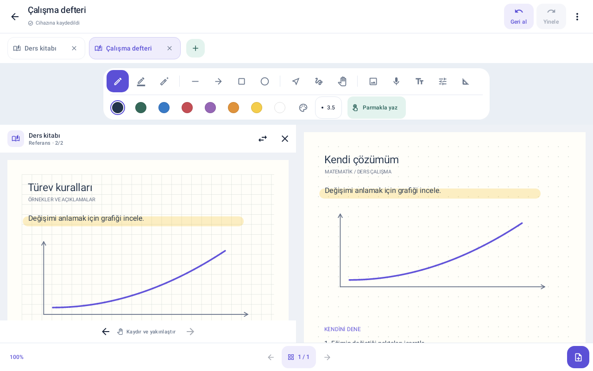
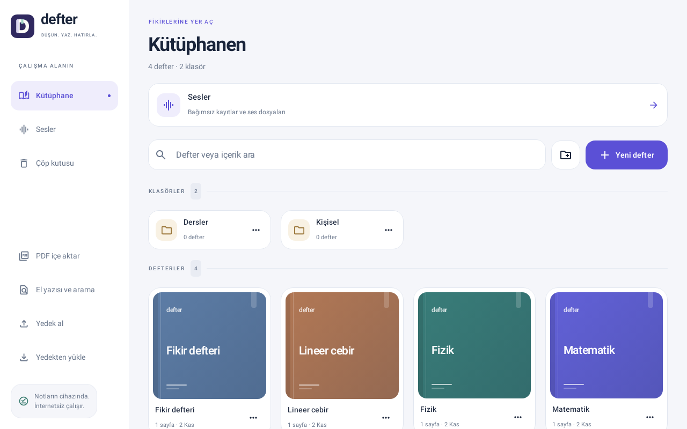
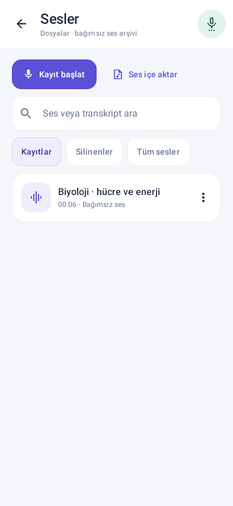
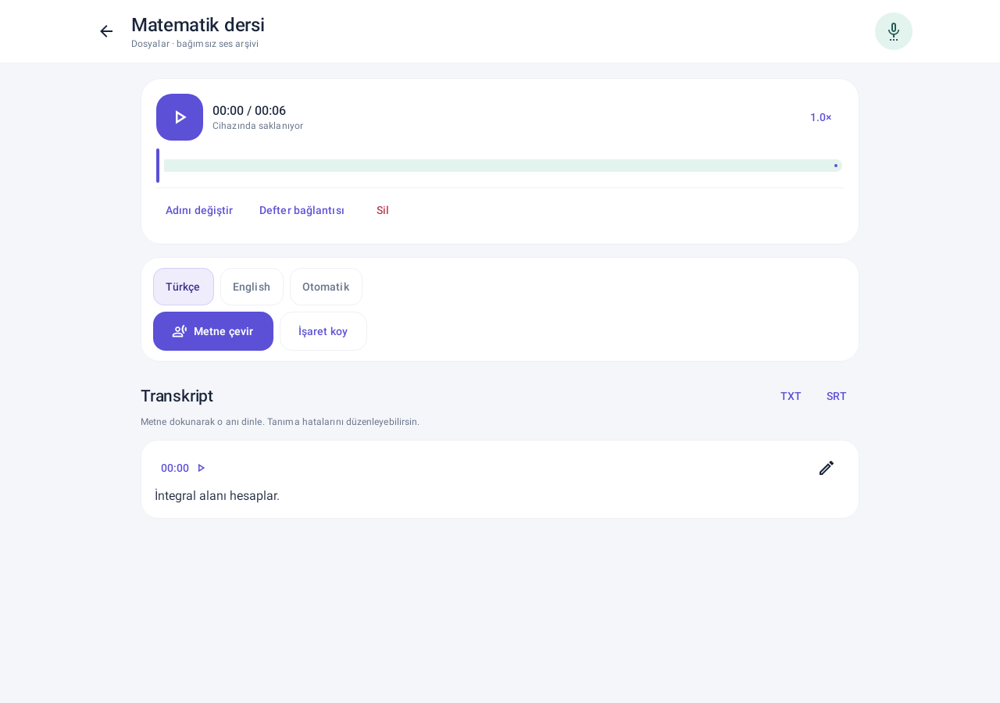

Defter lets you handwrite notes, annotate PDFs, and turn recordings into searchable text on your Android phone or tablet.

<div align="center">

# Defter

**Your notebooks, documents, and recordings in one place.**

An Android notebook with pressure-sensitive ink, PDF annotation, local backups, and on-device speech transcription.

[English](README.md) · [Türkçe](README.tr.md)

[Get started](#get-started) · [Build from source](#build-from-source) · [Validation](docs/VALIDATION.md) · [Report an issue](https://github.com/ArdaHFO/defter-android/issues)


</div>

## Overview

Defter brings handwritten pages, imported documents, and audio into a local library. Organize notebooks into folders, write beside a reference document, and link a recording to the page you were using. After downloading the optional models, handwriting recognition and speech transcription run on the device. The current interface is Turkish. Version 0.4 brings a shared indigo/mint theme, redesigned notebook covers and folders, a new adaptive icon, and short selection and press animations.

This repository contains the **0.4.0-alpha** source. Physical-device validation remains incomplete, especially for stylus behavior, microphone recording, and transcription performance. See [current limits](#current-limits) before relying on it for important notes.

## Preview

<p align="center">
  
  
</p>
<p align="center">
  
  
</p>

These 0.4.0-alpha previews were rendered with Robolectric on 2 November 2026 using synthetic notebook and audio content. They show the current library, editor, and audio interface, and are not physical-device screenshots.

## What you can do

| Workflow | Features |
| --- | --- |
| Write and draw | Pressure-sensitive pen, highlighter, whole-stroke or partial eraser, shapes, lasso selection, custom colors, zoom and pan. |
| Organize notes | Folders, notebook tabs, page previews and reordering, copy or move pages, trash and restore, and a read-only reference pane. |
| Work with documents | Import and annotate PDFs, add images and text, crop or rotate images, and export notebooks as PDF. |
| Find handwriting | Download a Turkish or English handwriting model, review recognized text, and index handwriting alongside text boxes. |
| Keep audio with notes | Record, pause and resume, import audio, add timestamps and page links, and play at 0.5–2× speed. |
| Turn speech into text | Download the multilingual Whisper base model, transcribe completed recordings locally, edit and search transcripts, jump to timestamps, and export TXT or SRT. |
| Preserve your work | Automatic local saving, conflict recovery copies, and editable `.defter` backups with SHA-256 checks that include recordings and transcripts. |

## Get started

Build a development APK using the instructions below, then install it on a dedicated Android 8.0+ phone or tablet. The source snapshot does not include a signed store release or bundled model weights.

1. Choose **Yeni klasör** or **Yeni defter** to organize your library and select a page template.
2. Write with the pen or highlighter. Use the page menu to import a PDF, add an image, or create a text box. **Yan yana aç** opens a reference pane.
3. Open **Sesler** from the library, or the microphone action inside a notebook, to record or import audio. Microphone access is requested when you start recording.
4. For speech recognition, choose **Konuşma modelini indir** once. The approximately **148 MB** model is checked against a pinned SHA-256 hash. Choose **Metne çevir** after recording and review the result.
5. For handwriting, choose a language under **El yazısı ve arama** and download its model. Recognition handles handwritten strokes, not text inside photographs or PDFs.
6. Export a `.defter` library backup and keep a copy outside the device. Export PDF or transcript text when you need a shareable copy.

The [detailed Turkish guide](docs/DEVELOPMENT.tr.md) covers selection, erasing, page management, storage limits, backups, and device testing.

## Build from source

The checked-in build uses **JDK 17**, **Gradle 8.13**, **Android SDK 35 / Build Tools 35.0.0**, **NDK 28.2.13676358**, and **CMake 3.22.1**. The first dependency download requires internet access. The pinned whisper.cpp source is included, so CMake does not download its engine source.

```powershell
git clone https://github.com/ArdaHFO/defter-android.git
cd defter-android

# Set JAVA_HOME and ANDROID_HOME (or ANDROID_SDK_ROOT) to installed tools.
.\build.ps1 -Action Check
.\build.ps1 -Action Build
```

The APK is written to `app/build/outputs/apk/debug/app-debug.apk`.

| Action | Result |
| --- | --- |
| `Check` | Unit/UI tests and Android Lint. This is the script default. |
| `Test` | Local JVM/Robolectric tests. |
| `Native` | C/C++ engine compilation for all four configured ABIs. |
| `Build` | Development APK and, if absent, a local debug signing key. |

The PowerShell helper isolates caches under `.local/` and handles short temporary paths needed by Windows. A custom `-SocketDirectory` must be writable and shorter than 85 characters. Keep `.local/debug.keystore` private and retain it if you want future development APKs to update the same installation without a signature mismatch. Keys and caches are not included in this repository.

The four configured ABIs are `arm64-v8a`, `armeabi-v7a`, `x86_64`, and `x86`. Compatibility does not guarantee useful transcription speed on low-memory or older devices. PDF and native Android instrumentation tests are under `app/src/androidTest`; running them requires a separate emulator or device and installs test APKs.

## Data and models

Notes, recordings, and transcripts stay in app-local storage. File import and export use Android's document picker. There is no account login, cloud synchronization, or note/audio upload workflow. Network access is used for optional model downloads. Transcription does not require an API key or subscription.

The speech engine is the vendored **whisper.cpp v1.9.5** with the multilingual **Whisper base** model. Model weights are downloaded only on request and are not checked in. Handwriting uses **ML Kit 19.0.0** and brings Google client-library dependencies, so the app is not described as Google Play Services independent. See [engine and model provenance](third_party/WHISPER_SOURCE.md).

## Validation

The completed **2 November 2026 validation for 0.4.0-alpha** records **244 passing tests in 39 suites**, **0 Android Lint errors / 22 warnings**, successful Android test-source compilation, and a development APK build. The first full test attempt hit a Windows file-access error during audio test setup. The second complete run passed without changing storage code.

The existing APK report verifies its signature, matching update certificate, ZIP/64-bit native-library alignment, and an Android emulator update from 0.3.0-alpha. Library/audio navigation and opening an existing notebook passed. All eight pre-existing content/test files retained their hashes; a separate installation marker changed as expected. This smoke check did not exercise the microphone, model download, or inference.

During repository preparation, all **1,555 source/configuration files** in the completed design-validation manifest matched their recorded hashes. These are preserved results from the completed validation workflow, not checks rerun for publication. The older native-audio harness remains separately identified as 0.3.0 evidence. [Validation scope and retained evidence](docs/VALIDATION.md) give the details.

## Current limits

- This is an alpha. Physical S Pen behavior, palm rejection, microphone sessions, long recordings, battery use, thermal behavior, and device-specific speed still need validation.
- Speech transcription runs after recording. Live captions, speaker separation, translation, cloud sync, and collaborative editing are not implemented.
- Handwriting recognition reads ink strokes. It does not perform photo/PDF OCR or convert equations to LaTeX. Real handwriting accuracy and model downloads need physical-device evaluation.
- Imported PDF bytes are retained, but their backgrounds are rasterized during display and PDF export. The original searchable PDF text layer is not preserved in the exported notebook.
- Imported images may be downsampled and normalized to PNG. Audio support depends on Android's codecs. A process interruption can lose the final unfinished recording segment.
- Undo keeps the latest 60 edits in the current page session. Switching pages resets that history.
- Older V1/V2 documents can be read, but saves use V3. Older APKs cannot read V3 documents. Preserve backups before changing app versions.
- Imports and backups have explicit size limits. The detailed guide lists the 64 MiB PDF, 256 MiB audio, and 512 MiB expanded-backup limits.

## Project map

| Path | Responsibility |
| --- | --- |
| `app/src/main/java/dev/defter/app/model/` | Notebook, page, audio, and transcript models. |
| `app/src/main/java/dev/defter/app/data/` | Atomic JSON persistence, imports, backups, and conflict recovery. |
| `app/src/main/java/dev/defter/app/ink/` | Canvas input, rendering, selection, and geometric editing. |
| `app/src/main/java/dev/defter/app/ui/` | Compose notebook and audio workspaces. |
| `app/src/main/java/dev/defter/app/audio/` | Recording, playback, decoding, model download, and transcription. |
| `app/src/main/java/dev/defter/app/recognition/` | Handwriting recognition integration. |
| `app/src/main/cpp/` | JNI bridge to the pinned native engine. |
| `app/src/test/`, `app/src/androidTest/` | Local and Android-device test sources. |
| `third_party/` | Required native source, licenses, and model provenance. |
| `docs/` | Detailed guide, scoped validation evidence, and UI captures. |

## Contributing

Describe the Android version, device, steps, and expected behavior when reporting an issue. Use synthetic notebooks or recordings in reproductions. Changes to persistence should preserve existing documents and backup compatibility. Include relevant local checks, and identify separately any device or native-engine checks actually performed.

## License and credits

No repository-wide license for Defter's original code was supplied with this source snapshot. Do not assume a reuse license from the licenses of its dependencies.

The vendored [whisper.cpp](https://github.com/ggml-org/whisper.cpp) source retains its [MIT license](third_party/whisper.cpp/LICENSE), [authors](third_party/whisper.cpp/AUTHORS), and nested third-party notices. The Whisper model has a separate [MIT license](third_party/WHISPER_MODEL_LICENSE.txt). Copies of the engine and model notices are also included in the app's assets. Kotlin, AndroidX, ML Kit, and the remaining dependencies retain their respective licenses.
