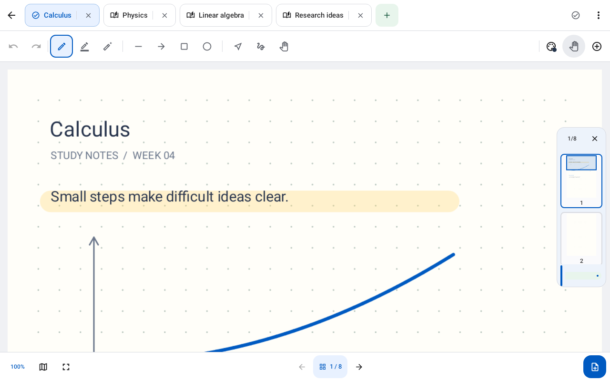
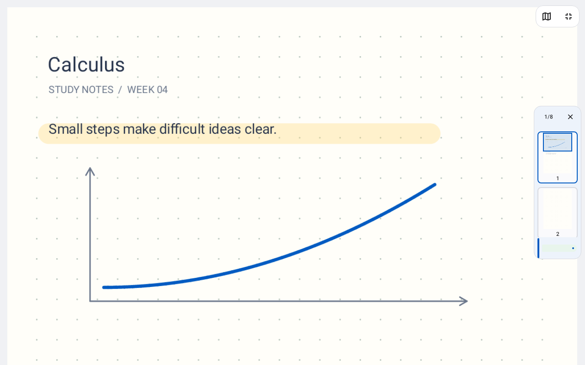
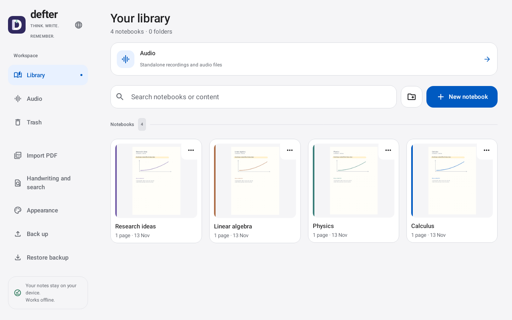
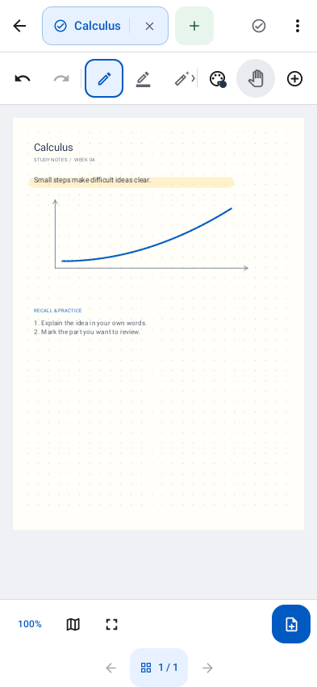
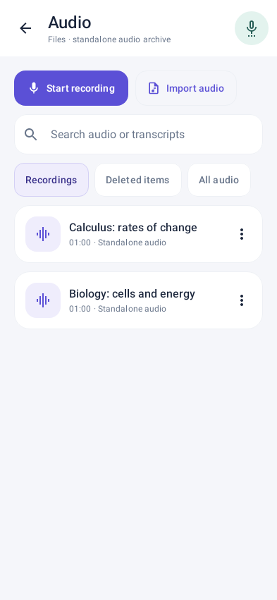
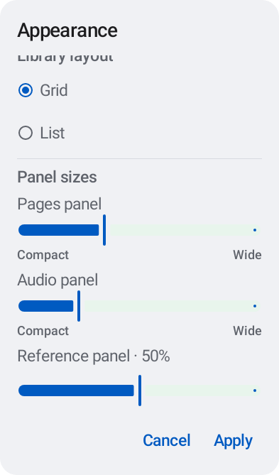
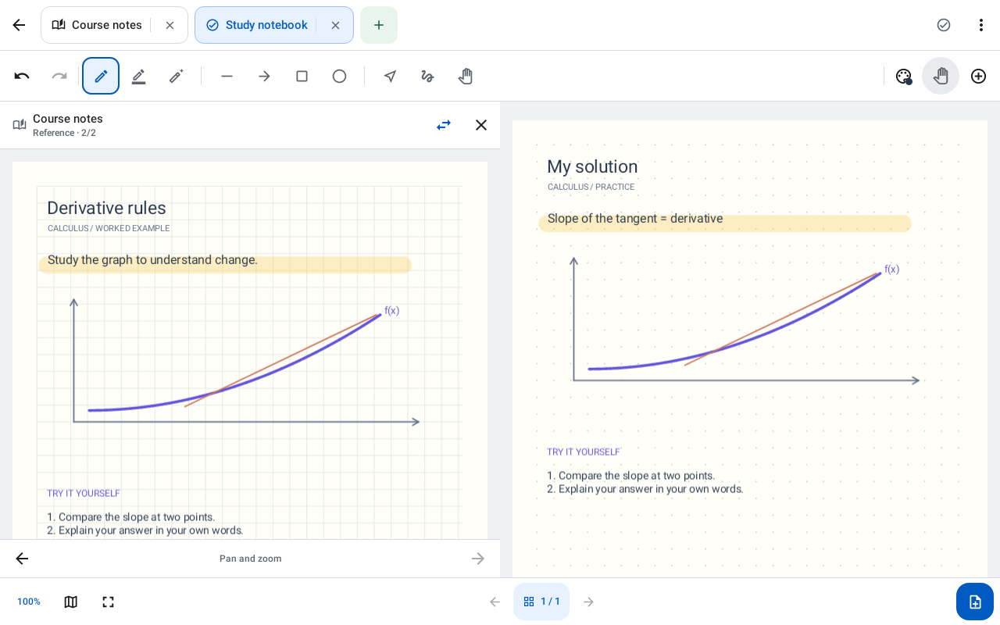
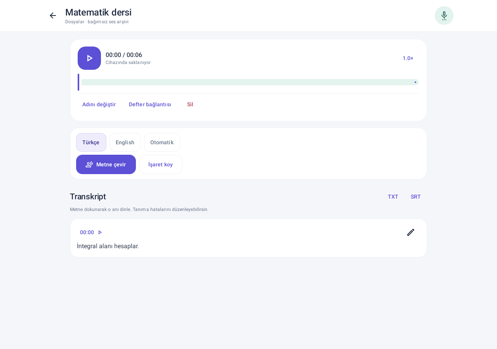
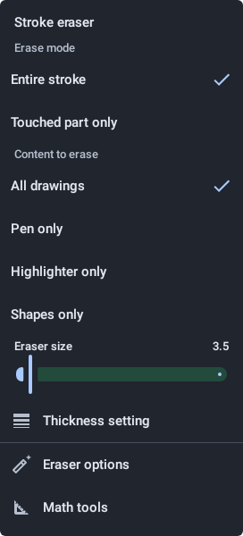

Defter, Android telefon veya tablette el yazısıyla not almanı, PDF üzerine yazmanı ve ses kayıtlarını aranabilir metne dönüştürmeni sağlar.

<div align="center">

# Defter

[English](README.md) · [Türkçe](README.tr.md)

[Başlangıç](#başlangıç) · [Dil desteği](#dil-desteği) · [Kaynaktan derleme](#kaynaktan-derleme) · [Doğrulama](docs/VALIDATION.md) · [Sorun bildir](https://github.com/ArdaHFO/defter-android/issues)


</div>

Defterler ve ses kayıtları cihazda saklanır. Bunları klasörlere ayırabilir, bir referans belgenin yanında çalışabilir ve kayıttaki bir anı not sayfasına bağlayabilirsin. El yazısı tanıma ve konuşmayı metne çevirme, modeller indirildikten sonra cihaz üzerinde çalışır. Hesap, API anahtarı veya abonelik gerekmez.

Güncel kaynak kod **14 Kasım 2026** tarihli **0.8.0-alpha** sürümüdür. Sayfalar arasında kesintisiz kaydırabilir, aynı anda görünen iki komşu sayfaya da yazabilirsin. 0.8 sürümünde sayfa haritası ve odak modu eklendi. Uygulama İngilizce açılır. **App language → Türkçe → Apply** ile Türkçeye geçebilirsin. Bu ayar arayüzü değiştirir, notların içeriğini çevirmez.

## Görünüm

<p align="center">
  
  
  
</p>
<p align="center">
  
  
  
</p>
<p align="center">
  
  
  
</p>

Bu görüntüler, örnek notlar, sessiz ses dosyaları ve elle eklenen transkript metniyle uygulamanın Robolectric/View ortamında çizilmesiyle alındı. Arayüzü gösterirler. Fiziksel cihaz veya konuşma tanıma doğruluğu testi değildirler. [Görüntülerin nasıl alındığı](docs/images/README.md).

## Notlar ve ses kayıtlarıyla çalışma

- **Defterler ve sayfalar.** İç içe klasörler oluşturabilir, ilk sayfayı kapakta görebilir ve başlıklarda arama yapabilirsin. Sayfaları çoğaltabilir, sıralayabilir, başka defterlere taşıyabilir veya kopyalayabilirsin. Son sayfanın altından çekip bırakmak bir sayfa ekler. Her defterde en az bir etkin sayfa kalır.
- **Yazma ve düzenleme.** Basınca duyarlı kalem, fosforlu kalem, özel renk ve kalınlık ayarları bulunur. Boş, çizgili, kareli, noktalı veya Cornell kâğıdı seçilebilir. Silgi tüm çizgiyi ya da bir kısmını silebilir. Kalem, fosforlu kalem ve şekil filtreleri vardır. Metin, görsel ve PDF arka planını silmez.
- **Şekiller ve seçim.** Çizgi, ok, dikdörtgen ve elips çizebilir, açı sabitleme veya kare/daire kısıtlarını kullanabilirsin. Nesne seçimi ve kementle taşıma, ölçekleme, renklendirme, çoğaltma ve silme yapılır. Düzenlenebilir seçimler sayfalar ve defterler arasında kopyalanabilir. Seçili metin Android panosuna da aktarılır.
- **Görsel ve metin.** Dosyalardan, galeriden, Android paylaşımından veya desteklenen pano içeriğinden eklenebilir. Görseller kırpılır, döndürülür ve yeniden boyutlandırılır. Metin kutuları düzenlenebilir. Düzenleme taslakları ekran döndürülünce korunur.
- **Çalışma alanı.** Birden fazla defteri sekmelerde açabilir ve ayrı gezinebilen bir referans sayfası ekleyebilirsin. Referans tablette editörün yanında, dar ekranda üstünde veya altında görünür. Düzenlemek için editörle yer değiştir. Sayfa haritası uzun defterlerde gezinmeyi kolaylaştırır. Odak modu araç ve sistem çubuklarını gizler. Tema ve panel ayarları kâğıt ve mürekkep renklerini değiştirmez.
- **Ses kaydı ve dinleme.** Yazarken kayıt alabilir veya sesleri ayrı klasörlerde tutabilirsin. Kaydı duraklatma, sürdürme, içe aktarma, yeniden adlandırma ve taşıma desteklenir. Sayfaya bağlı zaman işaretleri ekleyebilir, 0,5–2× hızda dinleyebilirsin.
- **Transkriptler.** Tamamlanan kayıtlar çevrimdışı metne çevrilir. İşlemi duraklatıp sürdürebilir, sonucu arayabilir ve düzeltebilirsin. Zaman damgasından dinleme, bir bölümü nota ekleme ve TXT/SRT çıktısı alma vardır. Android aşırı ısınma veya işlem süresi sınırı bildirirse transkripsiyon duraklar.
- **Kayıt ve yedekleme.** Notlar otomatik kaydedilir. Kayıt durumu, yeniden deneme ve kaydedilemeyen değişikliklerden kurtarma kopyası oluşturma bulunur. Sürüm kontrolü, eski bir düzenlemenin daha yeni kaydı sessizce ezmesini engeller. `.defter` yedeği notları, varlıkları, sesleri ve transkriptleri sürüm ve SHA-256 kontrolleriyle saklar. Geri yükleme, yedeği mevcut kütüphaneyle birleştirir.

Defterler, sayfalar ve sesler çöp kutusundan geri alınabilir. Kalıcı silme onay gerektirir. Bir defteri silmek bağlı sesleri korur, silinen sayfalara olan bağlantıları kaldırır. İlgili öğeleri silmeden önce kaydı durdurmak, transkripsiyonu duraklatmak veya durdurmak gerekir. Kalıcı silinen öğeler yedeklere girmez.

## Başlangıç

Aşağıdaki adımlarla geliştirme APK'sını derleyip **Android 8.0 veya üzeri** bir cihaza kur. Repo model ağırlıklarını veya mağaza imzalı bir sürümü içermez. Alpha sürümünü kullanırken önemli notların bir yedeğini cihaz dışında sakla. İlk açılış İngilizce olduğu için aşağıdaki adımlar İngilizce düğme adlarını kullanıyor.

1. **New folder** veya **New notebook** seç. Defteri bir klasörde oluşturacaksan önce o klasöre gir, ardından kapak rengini ve kâğıt şablonunu seç.
2. Parmakla gezinip kalemle yazmak için **Finger: pan** modunu kullan. Parmakla çizmek veya pasif kalem kullanmak için **Finger: draw** seç. İki parmak yakınlaştırır, genişliğe sığdırma görünümü sıfırlar. Desteklenen kalemlerde yan düğme geçici olarak silgiyi açar, bırakınca önceki araç ayarlarına döner.
3. **Import PDF** ile belge al veya editörden görsel ve metin ekle. Sayfa numarası **Pages** görünümünü açar. Parmakla taşıma modunda uzun basmak pano menüsünü getirir. **Eraser options** ve **Math tools** ek araç ayarlarını açar.
4. **Appearance** bölümünden tema ve panel boyutlarını ayarla. Alttaki simgeden sayfa haritasını, tam ekran simgesinden odak modunu aç. Geri tuşuyla odak modundan çıkabilirsin. Sekme artısı başka defter açar. **Open side by side** referans ekler, **Edit reference** onu düzenleme tarafına alır.
5. **Audio** içinden **Start recording** veya **Import audio** seç. Kayıt için mikrofon izni istenir ve ön plan bildirimi gösterilir. Yazarken zaman işareti ekleyerek sesi o sayfaya bağlayabilirsin.
6. **Speech model → Download model** ile konuşma modelini indir. Kaydı durdur, **Turkish**, **English** veya **Automatic** seçip **Transcribe** düğmesine bas. Metni kullanmadan önce gözden geçir. El yazısı için **Handwriting and search** bölümünden dil modelini indir ve **Prepare handwriting for search** seç. Yeni yazı ekledikten veya mürekkebi değiştirdikten sonra dizini güncelle.
7. **Back up** ile düzenlenebilir `.defter` yedeğini cihaz dışında sakla. **Restore backup** bunu kütüphaneye ekler. **Trash** veya seslerin **Deleted items** bölümünde öğeleri tek tek ya da **Select all** ile seçebilirsin. Kalıcı olarak silmek istediğinde **Delete selected** işlemini onayla.

Kontroller ve depolama ayrıntıları [Türkçe kılavuzda](docs/DEVELOPMENT.tr.md). Kılavuzdaki düğme adlarını izlemek için arayüzü Türkçeye geçir. Arayüz, el yazısı tanıma ve konuşma tanıma dilleri birbirinden ayrı ayarlardır.

## Dil desteği

| Özellik | Kullanılabilir diller |
| --- | --- |
| Arayüz | Varsayılan İngilizce veya Türkçe |
| El yazısı | ML Kit üzerinden Türkçe (`tr-TR`) ve İngilizce (`en-US`) |
| Konuşma seçenekleri | Türkçe (`tr`), İngilizce (`en`) ve Otomatik (`auto`) |

İndirilen [Whisper base modeli](https://huggingface.co/openai/whisper-base) **99 dili kapsayan bir sözlük** kullanır. Otomatik mod bu diller arasında algılama yapmayı deneyebilir. Uygulamada 99 ayrı dil seçeneği yoktur ve bu dillerin hepsi Defter'de test edilmedi. Sayı, bu modelin `n_vocab = 51865` değerinden gelir. Motorun listesindeki Kantonca başka modeller içindir ve base modelin bu kümesine dahil değildir. Transkripsiyon kaynak dili korur, çeviri kapalıdır.

## Veriler ve model indirmeleri

Notlar, sesler ve transkriptler uygulamanın cihazdaki alanında tutulur. İçe ve dışa aktarma, geniş depolama izni istemeden Android dosya seçicisini kullanır. Bulut eşitleme veya notları/sesleri sunucuya yükleme akışı yoktur. Ağ erişimi isteğe bağlı model indirmeleri içindir. Mikrofon yalnızca kayıt başlatıldığında açılır.

Konuşma tanıma, repoya dahil **whisper.cpp v1.9.5** ve çok dilli Whisper base modelini kullanır. **147.951.465 bayt**, yani yaklaşık **148 MB** olan model ayrıca indirilir. İndirme kaldığı yerden devam edebilir ve boyut/SHA-256 kontrolleriyle doğrulanır. Ardından transkripsiyon çevrimdışı çalışır. [Modelin kaynağı ve lisansı](third_party/WHISPER_SOURCE.md).

El yazısı tanıma **ML Kit 19.0.0** kullanır. Dil modelleri ayrıca indirilir. Google istemci kitaplıkları bağımlılıklar arasındadır. Google Play Services uygulaması olmayan cihazlarda indirme ve tanıma doğrulanmadı.

## Kullanmadan önce bilinmesi gerekenler

- **Cihaz desteği.** En düşük sürüm Android 8.0 / API 26, hedef SDK 35'tir. Basınç, yan düğme ve avuç içi ayrımı cihazın Android'e sağladığı girdilere bağlıdır. Fiziksel S Pen davranışı, mikrofon, uzun kayıt, pil, ısınma ve transkripsiyon hızı hedef cihazlarda ayrıca denenmeli. Uygulamanın kurulabilmesi, yeterli hızda çalışacağını göstermez.
- **Tanıma.** Konuşma kayıttan sonra metne çevrilir. Canlı altyazı, konuşmacı ayırma veya çeviri yoktur. Gürültü ve üst üste konuşma hatalara yol açabilir. El yazısı tanıma mürekkep çizgilerini okur. Fotoğraf OCR'ı, PDF metninde arama, denklem tanıma/LaTeX, kurşun kalem dokusu, yapay zekâ destekli çalışma araçları, ortak düzenleme ve bulut eşitleme uygulanmadı.
- **Düzenleme.** Referans paneli editörle yer değiştirene kadar salt okunurdur ve kendi tek sayfa görünümünü kullanır. Geri alma sayfa başına 60 düzenleme tutar. Normal kaydırmada önbellekteki geçmiş korunur. Doğrudan sayfa seçimi hedef sayfanın geçmişini sıfırlar, kaydedilmiş sayfa önbellekten çıkınca geçmişi de bırakılabilir. Kaydedilemeyen değişiklikler ayrıca korunur. Panodaki düzenlenebilir seçim, uygulama süreci kapandığında kaybolur.
- **Dosyalar.** İçe alınan özgün PDF saklanır. Defterin PDF çıktısında arka plan görüntüye dönüştüğü için aranabilir metin katmanı korunmaz. Görsellerin yönü düzeltilip PNG'ye dönüştürülür, özgün dosya baytları saklanmaz. Ses biçimleri Android'in çözücülerine bağlıdır. Kayıt yaklaşık 64 kbit/s mono AAC/M4A parçaları kullanır. İşlem sonlandırılırsa son tamamlanmamış parça kaybolabilir.
- **Yedekler ve silme.** V1/V2 belgeleri okunur, yeni kayıtlar V3 kullanır. Eski APK'lar V3 belgelerini okuyamaz. Sürüm değiştirirken uyumlu yedekleri koru. Kalıcı silme önce kütüphaneyi günceller, sonra başka yerde kullanılmayan dosyaları temizler. Temizlik başarısızsa diskte, yedeklere alınmayan ilişkisiz bir dosya kalabilir. Güvenli fiziksel veri imhası yapılmaz.

<details>
<summary>Dosya ve bellek sınırları</summary>

| Öğe | Sınır |
| --- | --- |
| İçe alınan PDF | 64 MiB / 2.000 sayfa |
| İçe alınan ses | Dosya başına 256 MiB |
| Çözümlenen ses | Çok parçalı kayıt üstverisi daha fazlasına izin verse de dosya başına 24 saat |
| El yazısı isteği | 200.000 mürekkep noktası |
| JSON belgesi | 32 MiB |
| Açılmış yedek | Toplam 512 MiB, 50.000 girdi |
| Yedek girdisi | Genel dosyalarda 64 MiB, seste 256 MiB |
| İçe alınan görsel | 4096 piksel kenar, 8.388.608 piksel |

Editör en fazla beş çözülmüş sayfayı bellekte tutar. Komşu sayfalarda küçük önizlemeler, doğrudan açılan etkin sayfada yaklaşık dört milyon piksel kullanılır. Yüklenmemiş sayfalar çizim kabul etmez. Sayfa haritası yalnızca görünen küçük resimleri, en fazla iki eşzamanlı işle hazırlar. Bunlar bellek ve dosya sınırlarıdır, ücretli defter veya sayfa kotası değildir.

</details>

## Kaynaktan derleme

**JDK 17**, **Gradle 8.13**, **Android SDK 35 / Build Tools 35.0.0**, **NDK 28.2.13676358** ve **CMake 3.22.1** kullan. Bağımlılıkların ilk indirmesi internet gerektirir. Sabitlenmiş whisper.cpp kaynağı repoda bulunduğundan CMake motoru ayrıca indirmez.

```powershell
git clone https://github.com/ArdaHFO/defter-android.git
cd defter-android

# JAVA_HOME ve ANDROID_HOME (veya ANDROID_SDK_ROOT) kurulu araçları göstermelidir.
.\build.ps1 -Action Check
.\build.ps1 -Action Build
```

APK, `app/build/outputs/apk/debug/app-debug.apk` dosyasına yazılır.

| İşlem | Yaptığı iş |
| --- | --- |
| `Check` | Yerel testleri ve Android Lint'i çalıştırır. Varsayılan işlemdir, APK üretmez. |
| `Test` | JVM/Robolectric testlerini çalıştırır, APK üretmez. |
| `Native` | Dört ABI için C/C++ motorunu derler, APK üretmez. |
| `Build` | Geliştirme APK'sı oluşturur, gerekirse debug imza anahtarı üretir. |

ABI'ler `arm64-v8a`, `armeabi-v7a`, `x86_64` ve `x86`. PowerShell betiği önbellekleri `.local/` altında tutar. Özel `-SocketDirectory` yazılabilir ve 85 karakterden kısa olmalı. Aynı kurulumları güncelleyebilmek için `.local/debug.keystore` dosyasını özel olarak sakla. Farklı bir anahtarla mevcut kurulum güncellenemez. Anahtarlar ve önbellekler repoya dahil değildir.

`app/src/androidTest` testleri ayrı bir emülatör veya cihaz gerektirir ve test APK'ları kurar. Bunları derlemek, çalıştırmak anlamına gelmez.

## Doğrulama

**13 Kasım 2026 / 0.8.0-alpha** kayıtlarında **393 başarılı JVM/Robolectric testi** ve **API35 x86_64 üzerinde kurulu R8 release sürümünde 13 başarılı Android testi** bulunur. Debug/release Lint sonuçları sıfır hata ve 22/20 uyarıdır. Mevcut içerik dosyalarının özetleri, örnek test verileri eklenmeden önce ve sonra kontrol edildi.

**14 Kasım yayını** için üç İngilizce önizleme kontrolü yeniden çalıştırıldı. Diğer güncel görüntüler, geçen 0.8 regresyon testlerinden alındı. Tam test paketi, native testler ve APK derlemesi yayın veya bu README düzenlemesi için yeniden çalıştırılmadı. [Doğrulama belgesi](docs/VALIDATION.md), bu sonuçların kapsamını ve fiziksel cihazlarda kalan kontrolleri açıklıyor.

## Kod ve katkı

Uygulama Kotlin, Compose, Android Canvas, atomik JSON kayıtları ve Whisper C/C++ kullanır. Jetpack Ink veya Room kullanılmıyor.

| `app/src/` altındaki yol | İçerik |
| --- | --- |
| `main/java/dev/defter/app/model/`, `main/java/dev/defter/app/data/` | Belgeler, kayıt, içe aktarma, yedekleme ve kurtarma |
| `main/java/dev/defter/app/ink/`, `main/java/dev/defter/app/ui/` | Çizim, hareketler, defter ve ses ekranları |
| `main/java/dev/defter/app/localization/` | Arayüz dilleri |
| `main/java/dev/defter/app/audio/`, `main/java/dev/defter/app/recognition/` | Kayıt, transkripsiyon ve el yazısı |
| `main/cpp/` | Native motor bağlantısı |
| `test/`, `androidTest/` | JVM ve Android testleri |

`third_party/` motor kaynağını ve lisans bildirimlerini, `docs/` kılavuzu, doğrulama kayıtlarını ve önizlemeleri içerir.

Hata bildirirken cihazı, Android sürümünü ve sorunu oluşturan adımları ekle. Mümkünse kişisel notlar yerine örnek not veya kayıt kullan. Veri saklama değişikliklerinde mevcut belgeleri ve yedek uyumluluğunu koru. Hangi yerel, native ve cihaz kontrollerini gerçekten çalıştırdığını belirt.

## Lisans ve kaynaklar

Defter'in özgün kodunu kapsayan bir repo lisansı yok. Bağımlılık lisansları uygulamanın tamamını lisanslamaz.

Repodaki [whisper.cpp](https://github.com/ggml-org/whisper.cpp), [MIT lisansını](third_party/whisper.cpp/LICENSE), [yazar listesini](third_party/whisper.cpp/AUTHORS) ve alt bileşen bildirimlerini korur. Modelin ayrı bir [MIT lisansı](third_party/WHISPER_MODEL_LICENSE.txt) vardır. İki bildirimin kopyaları uygulama varlıklarında da bulunur. Kotlin, AndroidX, ML Kit ve diğer bağımlılıklar kendi lisanslarına tabidir.
