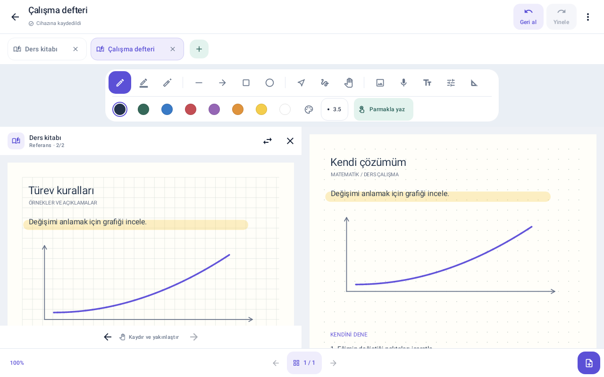
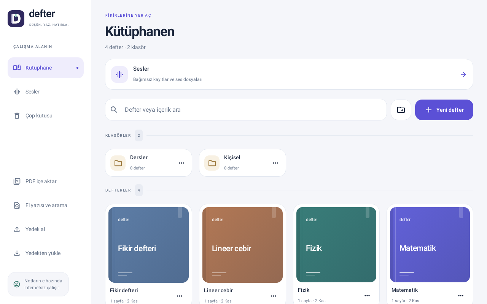
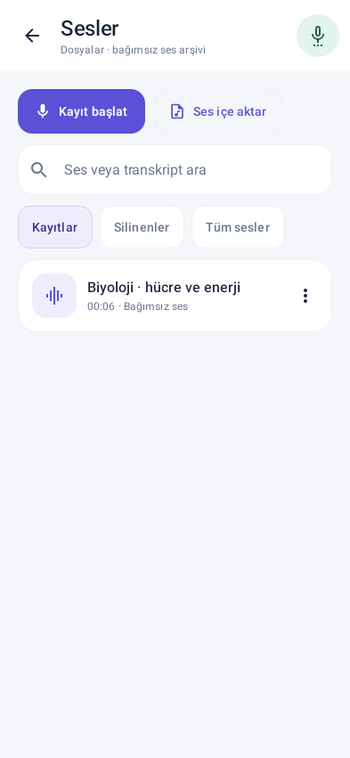
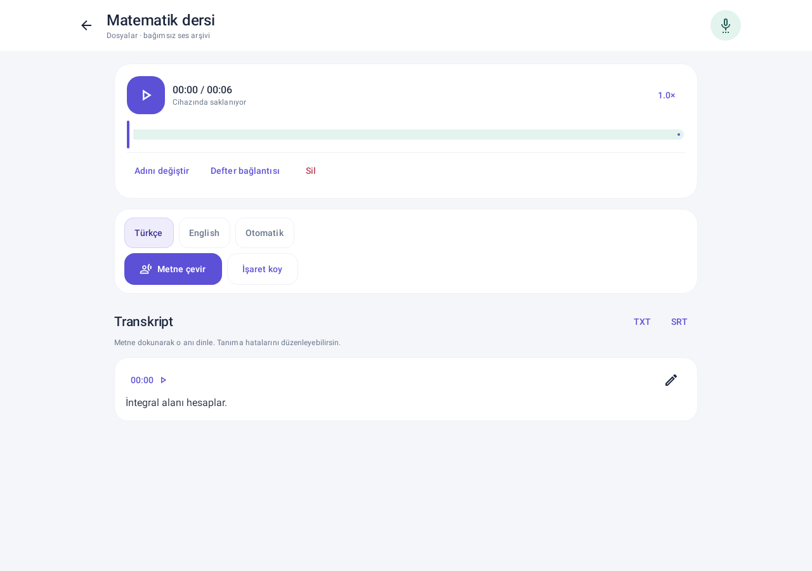

Defter, Android telefon veya tabletinizde el yazısıyla not almanızı, PDF üzerine yazmanızı ve ses kayıtlarını aranabilir metne dönüştürmenizi sağlar.

<div align="center">

# Defter

**Defterleriniz, belgeleriniz ve ses kayıtlarınız aynı yerde.**

Basınca duyarlı kalem, PDF üzerinde çalışma, yerel yedekler ve cihaz üzerinde konuşma tanıma sunan Android not defteri.

[English](README.md) · [Türkçe](README.tr.md)

[Başlangıç](#başlangıç) · [Kaynaktan derleme](#kaynaktan-derleme) · [Doğrulama](docs/VALIDATION.md) · [Sorun bildir](https://github.com/ArdaHFO/defter-android/issues)


</div>

## Genel bakış

Defter, el yazısı sayfaları, içe aktarılan belgeleri ve sesleri yerel bir kütüphanede birleştirir. Defterlerinizi klasörlere ayırabilir, bir referans belgenin yanında çalışabilir ve ses kaydını kullandığınız sayfaya bağlayabilirsiniz. İsteğe bağlı modeller indirildikten sonra el yazısı ve konuşma tanıma cihaz üzerinde çalışır. Güncel uygulama arayüzü Türkçedir. 0.4 sürümü ortak indigo/mint teması, yenilenmiş defter kapakları ve klasörler, yeni uyarlanabilir ikon ve kısa seçim/basma animasyonları getirir.

Bu depo **0.4.0-alpha** kaynağını içerir. Özellikle kalem davranışı, mikrofon kaydı ve transkripsiyon hızı için fiziksel cihaz doğrulaması henüz tamamlanmadı. Önemli notlarınız için kullanmadan önce [mevcut sınırları](#mevcut-sınırlar) inceleyin.

## Görünüm

<p align="center">
  
  
</p>
<p align="center">
  
  
</p>

Bu 0.4.0-alpha önizlemeleri, 2 Kasım 2026 tarihinde sentetik defter ve ses içeriğiyle Robolectric üzerinden çizilmiştir. Güncel kütüphane, editör ve ses arayüzünü gösterir. Fiziksel cihaz ekran görüntüsü değildir.

## Neler yapabilirsiniz?

| İş akışı | Özellikler |
| --- | --- |
| Yazma ve çizim | Basınca duyarlı kalem, fosforlu kalem, tam çizgi veya kısmi silgi, şekiller, kement seçimi, özel renkler, yakınlaştırma ve gezinme. |
| Notları düzenleme | Klasörler, defter sekmeleri, sayfa önizleme ve sıralama, sayfa kopyalama veya taşıma, çöp kutusu ve salt okunur referans paneli. |
| Belgelerle çalışma | PDF içe aktarma ve üzerine yazma, görsel ve metin ekleme, görsel kırpma veya döndürme, defteri PDF olarak çıkarma. |
| El yazısını bulma | Türkçe veya İngilizce modeli indirerek el yazısını tanıma, sonucu gözden geçirme ve metin kutularıyla birlikte arama. |
| Notlarla ses tutma | Kayıt, duraklatma ve devam, ses içe aktarma, zaman işaretleri ve sayfa bağlantıları, 0,5–2× oynatma. |
| Konuşmayı metne çevirme | Çok dilli Whisper base modeliyle tamamlanan kayıtları yerel dönüştürme, transkript düzenleme ve arama, zaman damgasından dinleme, TXT veya SRT çıktısı. |
| Çalışmayı koruma | Otomatik yerel kayıt, çakışma kurtarma kopyaları, ses ve transkriptleri de içeren SHA-256 kontrollü düzenlenebilir `.defter` yedekleri. |

## Başlangıç

Aşağıdaki adımlarla bir geliştirme APK'sı derleyip Android 8.0+ sürümlü, geliştirme için ayrılmış bir telefon veya tablete kurun. Kaynak ağacında mağaza imzalı bir sürüm veya model ağırlıkları bulunmaz.

1. **Yeni klasör** veya **Yeni defter** ile kütüphanenizi düzenleyin ve sayfa şablonunu seçin.
2. Kalem veya fosforlu kalemle yazın. Sayfa menüsünden PDF, görsel veya metin kutusu ekleyin. **Yan yana aç** referans panelini açar.
3. Kütüphanedeki **Sesler** bölümünden veya defterdeki mikrofon düğmesinden ses kaydedin ya da içe aktarın. Mikrofon izni kayıt başlatıldığında istenir.
4. Konuşma tanıma için **Konuşma modelini indir** seçeneğini bir kez kullanın. Yaklaşık **148 MB** model sabitlenmiş SHA-256 özetiyle doğrulanır. Kayıt bittikten sonra **Metne çevir** düğmesine basıp sonucu gözden geçirin.
5. El yazısı için **El yazısı ve arama** bölümünden dil seçip modelini indirin. Bu özellik fotoğraf veya PDF içindeki basılı metni değil, el yazısı çizgilerini okur.
6. `.defter` kütüphane yedeği çıkarıp cihaz dışında bir kopya saklayın. Paylaşılabilir kopyalar için PDF veya transkript çıktısı kullanın.

[Ayrıntılı Türkçe kılavuz](docs/DEVELOPMENT.tr.md), seçim, silgi, sayfa yönetimi, depolama sınırları, yedekleme ve cihaz testlerini açıklar.

## Kaynaktan derleme

Depodaki yapılandırma **JDK 17**, **Gradle 8.13**, **Android SDK 35 / Build Tools 35.0.0**, **NDK 28.2.13676358** ve **CMake 3.22.1** kullanır. İlk bağımlılık indirmesi için internet gerekir. Sabitlenmiş whisper.cpp kaynağı dahildir, CMake motor kaynağını ağdan indirmez.

```powershell
git clone https://github.com/ArdaHFO/defter-android.git
cd defter-android

# JAVA_HOME ve ANDROID_HOME (veya ANDROID_SDK_ROOT) kurulu araçları göstermelidir.
.\build.ps1 -Action Check
.\build.ps1 -Action Build
```

APK, `app/build/outputs/apk/debug/app-debug.apk` konumuna yazılır.

| İşlem | Sonuç |
| --- | --- |
| `Check` | Birim/arayüz testleri ve Android Lint. Betiğin varsayılan işlemidir. |
| `Test` | Yerel JVM/Robolectric testleri. |
| `Native` | Yapılandırılmış dört ABI için C/C++ motor derlemesi. |
| `Build` | Geliştirme APK'sı ve yoksa yerel geliştirme imzası. |

PowerShell betiği önbellekleri `.local/` altında ayırır ve Windows için kısa geçici yollar kullanır. Özel `-SocketDirectory` yolu yazılabilir ve 85 karakterden kısa olmalıdır. Sonraki geliştirme APK'larının imza uyuşmazlığı olmadan aynı kurulumu güncelleyebilmesi için `.local/debug.keystore` dosyasını özel olarak saklayın. Anahtarlar ve önbellekler bu depoya dahil değildir.

Yapılandırılmış ABI'ler `arm64-v8a`, `armeabi-v7a`, `x86_64` ve `x86` sürümleridir. Kurulum uyumluluğu, eski veya düşük bellekli cihazlarda kullanılabilir transkripsiyon hızı garantisi vermez. `app/src/androidTest` altındaki PDF ve yerel Android testleri ayrı bir emülatör veya cihaz gerektirir ve test APK'ları kurar.

## Veriler ve modeller

Notlar, sesler ve transkriptler uygulamanın yerel alanında saklanır. İçe ve dışa aktarma Android dosya seçicisini kullanır. Hesap girişi, bulut eşitleme veya not/ses yükleme akışı yoktur. Ağ erişimi isteğe bağlı model indirmeleri içindir. Transkripsiyon API anahtarı veya abonelik gerektirmez.

Konuşma motoru depoya eklenmiş **whisper.cpp v1.9.5**, model ise çok dilli **Whisper base** sürümüdür. Ağırlıklar yalnız kullanıcı isteğiyle indirilir ve depoda bulunmaz. El yazısı tanıma **ML Kit 19.0.0** ve Google istemci kitaplıklarını kullanır. Bu nedenle Google Play Services bağımsızlığı iddia edilmez. Ayrıntılar [motor ve model kaynağı](third_party/WHISPER_SOURCE.md) belgesindedir.

## Doğrulama

**0.4.0-alpha için 2 Kasım 2026 tarihinde tamamlanan doğrulama**, **39 sınıfta 244 başarılı test**, **0 Android Lint hatası / 22 uyarı**, başarılı Android cihaz testi kaynağı derlemesi ve geliştirme APK'sı üretimi kaydeder. İlk tam test denemesinde ses testinin veri hazırlığında Windows dosya erişim hatası oluştu. Depolama kodu değiştirilmeden yapılan ikinci tam çalıştırma geçti.

Mevcut APK raporu imzayı, önceki sürümle aynı güncelleme sertifikasını, ZIP/64 bit yerel kütüphane hizalamasını ve Android emülatöründe 0.3.0-alpha üzerine güncellemeyi doğrular. Kütüphane/ses gezinmesi ve mevcut defterin açılması geçti. Önceden var olan sekiz içerik/test dosyasının özetleri korundu, ayrı kurulum işaretçisi beklendiği gibi değişti. Bu kısa kontrol mikrofon, model indirme veya çıkarım işlemlerini kapsamıyordu.

Depo hazırlanırken tamamlanan tasarım doğrulamasının manifestindeki **1.555 kaynak/yapılandırma dosyasının tamamı** kayıtlı özetleriyle eşleşti. Bunlar tamamlanmış doğrulama sürecinden korunan sonuçlardır, yayın hazırlığında yeniden çalıştırılmadı. Eski yerel ses düzeneğinin kanıtı ayrıca 0.3.0 sürümüyle belirtilir. Ayrıntılar [doğrulama kapsamı ve korunan kanıtlar](docs/VALIDATION.md) içindedir.

## Mevcut sınırlar

- Bu bir alpha sürümüdür. Fiziksel S Pen davranışı, avuç içi ayrımı, mikrofon oturumları, uzun kayıtlar, pil, sıcaklık ve cihaza özgü hız ayrıca doğrulanmalıdır.
- Transkripsiyon kayıt sonrasında çalışır. Canlı altyazı, konuşmacı ayırma, çeviri, bulut eşitleme ve ortak düzenleme yoktur.
- El yazısı tanıma mürekkep çizgilerini okur. Fotoğraf/PDF OCR'ı veya denklemleri LaTeX'e çevirme içermez. Gerçek el yazısı doğruluğu ve model indirme fiziksel cihazda değerlendirilmelidir.
- İçe aktarılan PDF'nin özgün baytları korunur. Görüntülemede ve PDF çıktısında arka plan raster olarak çizilir. Özgün aranabilir PDF metin katmanı defter çıktısına taşınmaz.
- Görseller küçültülüp PNG'ye dönüştürülebilir. Ses biçimi desteği Android çözücülerine bağlıdır. Sürecin kesilmesi, kaydın son tamamlanmamış parçasını kaybettirebilir.
- Geri alma geçmişi açık sayfa oturumundaki son 60 işlemi tutar. Sayfa değişince sıfırlanır.
- V1/V2 belgeler okunabilir, yeni kayıtlar V3 kullanır. Eski APK'lar V3 belgeleri okuyamaz. Sürüm değiştirmeden önce yedekleri koruyun.
- İçe aktarma ve yedekleme için boyut sınırları vardır. Ayrıntılı kılavuzda 64 MiB PDF, 256 MiB ses ve 512 MiB açılmış yedek sınırları açıklanır.

## Proje haritası

| Yol | Sorumluluk |
| --- | --- |
| `app/src/main/java/dev/defter/app/model/` | Defter, sayfa, ses ve transkript modelleri. |
| `app/src/main/java/dev/defter/app/data/` | Atomik JSON kaydı, içe aktarma, yedekleme ve çakışma kurtarma. |
| `app/src/main/java/dev/defter/app/ink/` | Canvas girdisi, çizim, seçim ve geometrik düzenleme. |
| `app/src/main/java/dev/defter/app/ui/` | Compose defter ve ses çalışma alanları. |
| `app/src/main/java/dev/defter/app/audio/` | Kayıt, oynatma, çözme, model indirme ve transkripsiyon. |
| `app/src/main/java/dev/defter/app/recognition/` | El yazısı tanıma bağlantısı. |
| `app/src/main/cpp/` | Sabitlenmiş yerel motora JNI bağlantısı. |
| `app/src/test/`, `app/src/androidTest/` | Yerel ve Android cihaz test kaynakları. |
| `third_party/` | Gerekli yerel motor kaynağı, lisanslar ve model bilgileri. |
| `docs/` | Ayrıntılı kılavuz, kapsamı belirtilmiş doğrulama kanıtları ve arayüz görüntüleri. |

## Katkı

Sorun bildirirken Android sürümünü, cihazı, adımları ve beklenen davranışı belirtin. Örneklerde yapay defter veya ses kayıtları kullanın. Depolama değişiklikleri mevcut belgeleri ve yedek uyumluluğunu korumalıdır. İlgili yerel kontrolleri bildirin, gerçekten yaptığınız cihaz veya yerel motor kontrollerini ayrıca belirtin.

## Lisans ve teşekkürler

Bu kaynak ağacında Defter'in özgün kodu için depo genelinde bir lisans bulunmuyordu. Bağımlılıkların lisanslarından uygulama için yeniden kullanım izni çıkarılmamalıdır.

Depoya eklenen [whisper.cpp](https://github.com/ggml-org/whisper.cpp) kaynağının [MIT lisansı](third_party/whisper.cpp/LICENSE), [yazarları](third_party/whisper.cpp/AUTHORS) ve içindeki üçüncü taraf bildirimleri korunmuştur. Whisper modelinin ayrı [MIT lisansı](third_party/WHISPER_MODEL_LICENSE.txt) vardır. Motor ve model bildirimlerinin kopyaları uygulama varlıklarına da dahildir. Kotlin, AndroidX, ML Kit ve diğer bağımlılıklar kendi lisanslarını korur.
